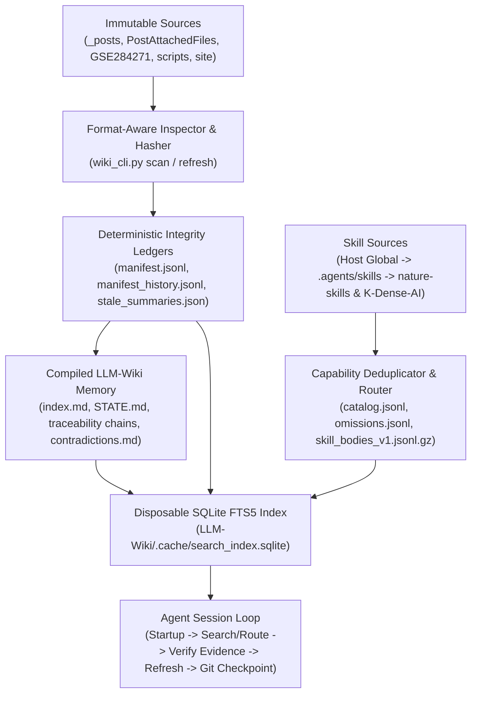

# `LLM-Wiki` — Persistent Project Memory, Biomedical Evidence Ledger, & Skill Router

`LLM-Wiki/` is the persistent, hash-verified knowledge base and agent workflow engine for **`LabOnoM.github.io`** (**Bioinformatics Study Group in Okayama University / LabOnoM**), inspired by [Andrej Karpathy's LLM Wiki](https://gist.github.com/karpathy/442a6bf555914893e9891c11519de94f).

It compounds verified understanding across **website & pipeline code**, **spatial/molecular biomedical evidence**, **contradictions & anomalies**, **decisions**, **cryptographic file integrity**, **Git/worktree state**, and **multi-tier reusable agent skills**—without altering original research files or relying on cloud indexing services.

---

## 1. Quick Navigation
| Entry Point | Purpose |
|---|---|
| [index.md](index.md) | Master categorized catalog of every `LLM-Wiki` summary page |
| [STATE.md](STATE.md) | Concise session-startup dashboard (branch, manifest counts, active contradictions, next actions) |
| [SCHEMA.md](SCHEMA.md) | Three-layer architecture, YAML `source_refs` invalidation rules, and citation standards |
| [overview.md](overview.md) & [code-map.md](code-map.md) | BSGOU mission, research gallery PMIDs, and verified file/symbol topology |
| [contradictions.md](contradictions.md) | `9` verified doc-vs-code/data contradictions and file-format anomalies (`CON-01`–`CON-09`) |
| [decisions.md](decisions.md) & [log.md](log.md) | Append-only architectural decision records and timestamped activity/validation history |
| [lessons-learned.md](lessons-learned.md) & [open-questions.md](open-questions.md) | Distilled engineering/biomedical rules and `6` open owner questions (`OQ-01`–`OQ-06`) |
| [git-state.md](git-state.md) & [manifest/OVERVIEW.md](manifest/OVERVIEW.md) | `raw_sha256` vs. Git blob SHA-1 vs. Commit SHA provenance, worktrees, and backup caveats |
| [skills/README.md](skills/README.md) | `1,539`-skill catalog (`global -> project -> external` router) + `273` explicit redundancy omissions |

### Scientific Traceability Chains (`Experiment -> Dataset -> Analysis -> Figure -> Result`)
1. **Murine Embryonic Palate Visium HD (`GSE284271` / `Pax9KO`)**: [Experiment](experiments/exp-gse284271-visiumhd-palate.md) $\to$ [Dataset](datasets/ds-gse284271-pax9ko-2um.md) $\to$ [Analysis](analyses/ana-stardist-visiumhd-binning.md) $\to$ [Figures](figures/fig-gse284271-segmentation-and-clustering.md) $\to$ [Result](results/res-gse284271-nuclei-binning.md)
2. **qPCR $2^{-\Delta\Delta C_T}$ Scale-Invariance & Log-vs-Linear Testing**: [Experiment](experiments/exp-qpcr-wt-vs-ko.md) $\to$ [Dataset](datasets/ds-example-qpcr-xlsx-and-prism.md) $\to$ [Analysis](analyses/ana-livak-2ddct-am-vs-gm.md) $\to$ [Figures](figures/fig-qpcr-excel-and-prism-panels.md) $\to$ [Result](results/res-qpcr-normalization-equivalence.md)
3. **BGI Stereo-seq `CID` Barcode Recovery (`Chip A02598A4`)**: [Experiment](experiments/exp-stereoseq-cid-decoding.md) $\to$ [Dataset](datasets/ds-a02598a4-barcodetopos-and-bam.md) $\to$ [Analysis](analyses/ana-st-barcodemap-vs-base4-hallucination.md) $\to$ [Figures](figures/fig-stereoseq-igv-ai-github-issue.md) $\to$ [Result](results/res-stereoseq-cid-ground-truth.md)

---

## 2. System Workflow Diagram



---

## 3. Setup & Zero-Dependency CLI Usage

`LLM-Wiki/scripts/wiki_cli.py` requires **only Python 3.9+ standard library** (`sqlite3`, `hashlib`, `zipfile`, `xml`, `gzip`, `tarfile`, `ast`)—no external `pip` install is needed. Disposable indexes live in gitignored `LLM-Wiki/.cache/`.

```bash
# 1. Startup: inspect Git/worktree state and run non-destructive incremental drift check
python3 LLM-Wiki/scripts/wiki_cli.py git-state
python3 LLM-Wiki/scripts/wiki_cli.py refresh --dry-run

# 2. Build or refresh the local SQLite FTS5 search index (auto-runs on first search)
python3 LLM-Wiki/scripts/wiki_cli.py index

# 3. Search across wiki summaries, file manifest records, and full skill bodies
python3 LLM-Wiki/scripts/wiki_cli.py search "Pax9KO StarDist total_counts"
python3 LLM-Wiki/scripts/wiki_cli.py search "variance F-test 1451" --scope wiki

# 4. Route a task across Global -> Project-Local -> Complementary External skills
python3 LLM-Wiki/scripts/wiki_cli.py route "Decode Stereo-seq barcodeToPos.h5 CID and bin Visium HD nuclei"
python3 LLM-Wiki/scripts/wiki_cli.py route "Query ChEMBL IC50 bioactivity for kinase target"

# 5. Progressively load ONLY the selected skill's SKILL.md body
python3 LLM-Wiki/scripts/wiki_cli.py skill-body "project:LabOnoM.github.io:spatial-omics-visiumhd-stereoseq"

# 6. After editing files: refresh manifest (retaining superseded SHA-256 history) & run all 7 verification gates
python3 LLM-Wiki/scripts/wiki_cli.py refresh --reindex
python3 LLM-Wiki/scripts/wiki_cli.py verify

# 7. On a fresh clone if LLM-Wiki/.cache/skill_bodies_v1.jsonl.gz is absent:
python3 LLM-Wiki/scripts/wiki_cli.py fetch-skill-cache
```

---

## 4. Epistemic & Operational Safeguards
- **Indexing $\neq$ Scientific Understanding**: SHA-256 hashes and format parsers verify byte-level provenance and detect drift; scientific claims require inspecting primary code, formulas, replicates, and figures.
- **Commit IDs $\neq$ Working-Tree Evidence**: Uncommitted or untracked files are identified by `raw_sha256` in `manifest.jsonl` plus `git_state.json`.
- **Hashes & Git $\neq$ Raw Data Backup**: External multi-GB omics inputs (`./240726_VisiumHD/*`, `A02598A4.*`) are untracked; institutional backup arrangements are currently **unknown** (`OQ-01`).
- **Manual CI Policy (`2026-10-13`)**: LabOnoM uses zero GitHub Actions. Always run `bundle exec jekyll build` and `python3 LLM-Wiki/scripts/wiki_cli.py verify` locally before merging to `main`.
