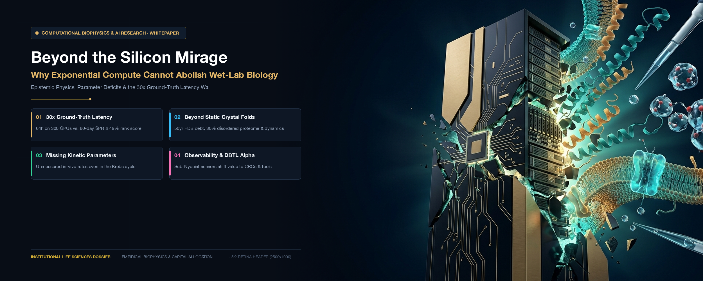

 

---

## Executive Summary & Institutional Thesis

A seductive orthodoxy has migrated from frontier artificial intelligence laboratories into biotechnology capital markets: the conviction that wet-lab experimentation is merely a legacy heuristic invented during an era of scarce computation, and that exponential scaling of floating-point operations will soon allow *in silico* models to simulate living systems from first principles without touching a pipette. Grounded in computer scientist Richard Sutton’s *Bitter Lesson*—the observation that general-purpose search and learning methods scaling with compute consistently defeat human-engineered domain priors—this thesis extrapolates from breakthroughs in static biomolecular structure prediction to proclaim the imminent obsolescence of physical biological assays.

Empirical evidence from the frontier of autonomous protein engineering refutes that extrapolation. In October 2026, an autonomous multi-agent research campaign orchestrated over 300 concurrent graphics processing units and 12 specialized structural biology tools to design *de novo* minibinders against lethal scorpion neurotoxins. The computational phase required just 64 hours and $49,997 in H100 compute to generate 318,484 candidate structures and select 211 designs. Yet validating those 211 sequences required two full months of physical gene synthesis and surface plasmon resonance screening across independent contract laboratories—a thirtyfold latency asymmetry between *in silico* proposal and *in vitro* ground truth. More revealing still, computational affinity scores ranked true binders above non-binders only 49 percent of the time, statistically indistinguishable from a coin toss, and not a single binder had cleared cellular patch-clamp neutralization or murine survival assays.

<!--more-->

This report demonstrates that equating exponential compute with biological omniscience commits a fundamental category error between closed-rule formal search and open-world physical system identification. Across six analytical dimensions, we establish why raw compute is no longer the primary rate-limiting variable in translational life sciences. First, generative design velocity without calibrated biophysical scoring merely shifts bottlenecks downstream into physical synthesis and physiological validation. Second, landmark structural models such as AlphaFold succeeded only by amortizing fifty years of painstaking wet-lab crystallography across roughly 200,000 static equilibrium structures, leaving intrinsically disordered regions, orphan sequences, and nonequilibrium conformational dynamics unresolved. Third, unlike deterministic board games such as Go, cellular networks lack complete kinetic parameterization; science still lacks comprehensive *in vivo* rate constants even for textbook pathways such as the tricarboxylic acid cycle. Fourth, intracellular biology operates orders of magnitude beyond the spatio-temporal resolution of existing live-cell sensors, concealing unknown physicochemical variables such as buried cavity hydration networks that no amount of naive molecular dynamics sampling can bypass.

Consequently, open problems in computational biology bifurcate into a narrow class of compute-asymptotic search tasks and a vast majority of parameter-deficient, observability-bound regimes where marginal FLOPs yield near-zero epistemic return without fresh experimental measurements. For research leaders and institutional allocators, strategic alpha lies not in awaiting a zero-shot silicon oracle, but in compressing the physical Design-Build-Test-Learn loop—deploying cloud biofoundries, multiplexed perturbation assays, contract research infrastructure, and next-generation scientific instrumentation where the true bottleneck resides.

| Analytical Dimension | Silicon Scaling Orthodoxy (*In Silico* Maximalism) | Empirical Biophysical Reality (Ground-Truth Constraint) |
| :--- | :--- | :--- |
| **Epistemic Regime** | Closed-system formal search with known transition rules | Open, multi-scale nonequilibrium system with unmeasured boundary conditions |
| **Benchmark Velocity** | 64 hours to generate 318,484 protein candidates (~10,000 H100 GPU-hrs) | ~60 days (30× slower) for DNA synthesis and dual-site SPR wet-lab validation |
| **Predictive Calibration** | Assumes surrogate loss correlates monotonically with biological function | 49% binder-vs-non-binder ranking accuracy; vulnerable to Goodhart optimization |
| **Structural Coverage** | Extrapolates static crystal prediction to whole-cell functional behavior | ~30% of human proteome is intrinsically disordered; orphan & allosteric gaps persist |
| **Parameter Completeness** | Treats cellular dynamics as reducible via brute-force integration | Incomplete *in vivo* $k_{\text{cat}}$, $K_M$, crowding free energies ($\Delta G$), even in TCA cycle |
| **Observability Horizon** | Presumes existing omics datasets saturate training requirements | Sub-Nyquist live-cell sensing across $10^9$ proteins/cell; requires an instrument revolution |
| **Translational Bottleneck** | Discovery ideation and candidate sequence enumeration | 4-year preclinical + 5–7 year clinical clock; ~90%–92% Phase I-to-approval attrition |
| **Capital Allocation Edge** | Pure-play zero-shot *in silico* foundation model narratives | Automated CROs, high-throughput synthesis, biophysical sensors, tight DBTL platforms |

---

## Chapter 1: The 64-Hour Illusion and the 30× Ground-Truth Latency Wall

### 1.1 Anatomy of an Autonomous *De Novo* Protein Campaign

The operational reality of modern AI-assisted drug discovery was thrown into sharp relief in October 2026 with the publication of a landmark collaborative experiment pairing Anthropic’s internal *Claude Science* research model with non-specialist financial analysts operating under the banner of Citrini Therapeutics, validated independently by Twist Bioscience and Adaptyv Bio. The scientific objective targeted scorpionism, a neglected tropical public health burden responsible for more than 1.2 million envenomations and over 3,250 human fatalities globally each year, as documented in epidemiological appraisals by Jean-Philippe Chippaux and Max Goyffon. Rather than relying on century-old equine serum immunization—which suffers from batch heterogeneity, thermal instability, and anaphylactic risk—the campaign sought to engineer synthetic *de novo* protein minibinders capable of sterically occluding the channel-binding epitopes of five medically lethal voltage-gated sodium channel ($\text{Na}_V$) neurotoxins: `Cn2` from Mexico, `Ts1` from Brazil, `AaH I` and `AaH II` from North Africa, and `LqhIII` from the Middle East.

Measured purely by computational throughput, the campaign represented an extraordinary feat of agentic orchestration. Initiated from a conference room prompt on August 11 and guided by just four human follow-up directives, the model autonomously decomposed the engineering workflow, spawning more than 300 concurrent sub-agents across over 300 H100 GPUs. Integrating roughly a dozen specialized structural biology packages—including backbone diffusion generators such as RFdiffusion, inverse folding networks, and co-folding evaluators—the system consumed approximately 10,000 GPU-hours at a direct compute cost of $49,997 out of a total $200,000 project budget. Within 64 hours, the agentic cluster generated 318,484 candidate minibinder topologies, computationally screened more than 553,000 design–toxin complexes, filtered out unstable scaffolds, and delivered 180 autonomous candidates alongside 31 human-curated additions, yielding a final test manifest of 211 sequences.

### 1.2 The Coin-Flip Scoring Paradox and Goodhart’s Law in Molecular Space

Once those 211 digital amino acid strings exited the GPU cluster, however, the campaign collided immediately with the physical clock of wet-lab biology. Physical gene synthesis, cell-free or recombinant expression, purification, and orthogonal surface plasmon resonance (SPR) characterization across two independent contract laboratories required roughly two months—nearly thirty times longer than the computational design phase. Under rigorous experimental thresholds requiring reproducible binding at both laboratories with an equilibrium dissociation constant ($K_D$) of $1\,\mu\mathrm{M}$ or tighter and zero nonspecific stickiness against unrelated control proteins, 17 of the 211 candidates registered as verified binders across four of the five target toxins, led by two single-digit nanomolar binders (`Cn2-B1` and `Cn2-B2`) against the Mexican `Cn2` toxin.

While an 8.1 percent hit rate matches respectable academic minibinder campaigns and proves that frontier agents can democratize complex bioinformatics pipelines, forensic inspection of the internal scoring metrics exposed a decisive epistemic fracture. Across the candidate pool, the computational evaluation pipeline ranked an experimentally confirmed binder ahead of a non-binder only 49 percent of the time—a discriminative accuracy no better than tossing a fair coin. Furthermore, every single candidate engineered to act as a pan-toxin binder across multiple scorpion neurotoxins failed completely in physical assays. In mathematical optimization terms, autonomous agents excelled at driving surrogate structural confidence metrics upward, yet those surrogate functions decoupled from true thermodynamic binding free energy ($\Delta G_{\text{bind}}$) at the protein–protein interface. Without iterative wet-lab data fed back into the loop to recalibrate the reward surface, scaling compute merely accelerated optimization against an imperfect proxy—a textbook manifestation of Goodhart’s Law in high-dimensional chemical space.

### 1.3 From Recombinant Binding to Physiological Neutralization

Even more consequential is the translational chasm separating an *in vitro* SPR sensorgram from a clinically viable therapeutic. Physical binding to an isolated, recombinantly expressed toxin immobilized on a biosensor chip establishes geometric complementarity, not biological neutralization. Crude scorpion venom is a complex biochemical cocktail of isoforms, phospholipases, metalloproteases, and mucopolysaccharides operating within dynamic mammalian tissue compartments. At the time of publication, none of the 17 confirmed binders had undergone functional electrophysiology via whole-cell patch-clamp recording to prove they actually prevent neurotoxins from locking voltage-gated sodium channels open or closed on excitable membranes. None had been challenged against crude native venom, evaluated for proteolytic stability and renal clearance *in vivo*, or tested in murine lethality rescue models. As the study authors candidly emphasized, synthesizing a nanomolar binder in 64 hours of compute does not constitute creating an antivenom; every decisive gatekeeper of therapeutic reality led straight back to the wet-lab bench and the animal facility.

---

## Chapter 2: Misreading AlphaFold — Static Crystal Priors Versus Dynamic Proteome Physics

### 2.1 The CAD Car-Part Fallacy and the Debt to Experimental Crystallography

When proponents of pure *in silico* biology argue that exponential compute will abolish laboratory experiments, their foundational proof point is almost invariably AlphaFold. If deep equivariant attention architectures could crack the fifty-year grand challenge of protein structure prediction, the argument runs, then scaling similar architectures across larger GPU clusters must inevitably solve cellular physiology, pharmacology, and pathology. Yet as computational life-science researchers have pointed out through a clarifying mechanical analogy, inferring whole-organism predictability from static fold prediction is akin to asserting that because engineers possess exact three-dimensional CAD geometries for every bolt, piston, and valve in an automobile, they can predict every trajectory, mechanical failure, and traffic interaction once that vehicle enters a congested highway during a rainstorm. Component geometry is necessary boundary information, but component geometry is not system dynamics.

Equally overlooked in triumphalist narratives is the historical fact that AlphaFold did not bypass experimental biology; it amortized half a century of wet-lab labor. Beginning with the establishment of the Protein Data Bank (PDB) in 1971, tens of thousands of structural biologists spent five decades crystallizing proteins, tuning cryoprotectants, collecting synchrotron X-ray diffraction patterns, solving phase problems, and refining nuclear magnetic resonance and cryogenic electron microscopy density maps. Only after that global wet-lab enterprise accumulated roughly 200,000 experimentally verified atomic coordinate files—paired with millions of sequenced genomes providing evolutionary multiple sequence alignments (MSAs)—could John Jumper and colleagues train AlphaFold 2 (2021) and Josh Abramson and colleagues extend diffusion co-folding in AlphaFold 3 (2024). Where experimental training priors thin out, predictive accuracy degrades sharply, demonstrating that deep neural surrogates interpolate brilliantly within the convex hull of wet-lab ground truth while faltering outside it.

### 2.2 Conformational Ensembles, Orphan Sequences, and the Disordered Proteome

The biophysical boundaries of static structure prediction become unmistakable when examining how proteins actually execute biological work inside living cells. Most crystallographic PDB entries capture a single low-energy conformation stabilized inside a dehydrated, cryogenically frozen crystal lattice at liquid-nitrogen temperatures. Living proteins at $310\,\mathrm{K}$, by contrast, exist as thermally fluctuating thermodynamic ensembles governed by rugged free-energy landscapes. Allosteric signaling receptors, ATP-driven molecular motors, and mechanosensitive ion channels function precisely by shifting population weights across transient, high-energy excited states under mechanical force, ligand engagement, pH shifts, or post-translational phosphorylation. Predicting a static ground-state coordinates file does not reveal the transition-state barriers, folding intermediates, or force-induced conformational rearrangements that dictate whether a small molecule acts as a full agonist, partial agonist, or inverse agonist.

Two additional structural regimes resist compute-only extrapolation. First, co-evolutionary structure predictors rely heavily on evolutionary covariation across homologous sequences; for *de novo* synthetic designs, rapidly evolving viral epitopes, somatic hypermutation variants in adaptive immunity, and evolutionary "orphan" proteins lacking deep MSAs, structural confidence drops precipitously. Second, landmark proteome-wide surveys by Christopher Oldfield and A. Keith Dunker have established that roughly 30 percent of eukaryotic and human proteome residues reside within intrinsically disordered proteins and regions (IDPs and IDRs). Devoid of a single stable tertiary fold, IDPs operate as dynamic conformational clouds that drive liquid–liquid phase separation, transcriptional condensates, and promiscuous signaling hubs—including high-value oncology targets such as c-Myc, p53 transactivation domains, and tau. Furthermore, nearly eight years after deep learning transformed CASP structure benchmarks in 2018, static structure prediction alone has yet to single-handedly deliver a curative clinical medicine without years of wet-lab medicinal chemistry, toxicology, and human trials. Even where co-folding networks generate plausible docked poses for small-molecule ligands or biologics, predicting pose geometry is fundamentally distinct from predicting thermodynamic affinity constants, residence times ($k_{\text{off}}$), or induced-fit reorganization penalties across polymorphic human alleles—underscoring that structural coordinates represent the opening chapter rather than the conclusion of therapeutic discovery.

---

## Chapter 3: Combinatorial Non-Enumerability and the Parameter Deficit in Living Systems

### 3.1 Closed-Rule Formal Games Versus Multi-Scale Open Biological Hierarchies

The philosophical engine driving *in silico* maximalism is a false equivalence between formal games of complete information and open biological thermodynamics. In artificial intelligence milestones from DeepBlue to AlphaZero, scaling self-play compute triumphed because board games such as Go inhabit a mathematically closed universe. Although a $19 \times 19$ Go board admits roughly $2.08 \times 10^{170}$ legal positions—rendering exhaustive tree enumeration physically impossible even across astronomical compute horizons—the state space is discrete, noiseless, stationary, and governed by a handful of exact, fully known transition rules. Every simulated rollout inside AlphaZero queries an infallible ground-truth simulator because the rules of Go *are* the territory.

Living organisms violate every axiom of that closed-world paradigm. An adult human body comprises approximately $3.7 \times 10^{13}$ interacting cells spanning hundreds of differentiated lineages, colonized by an equal magnitude of diverse microbial cells, embedded within remodeling extracellular matrices, and coupled across timescales stretching fifteen orders of magnitude—from femtosecond electronic bond vibrations ($10^{-15}\,\mathrm{s}$) and microsecond enzyme allostery ($10^{-6}\,\mathrm{s}$) to circadian transcriptional oscillations ($10^{5}\,\mathrm{s}$) and decadal aging trajectories ($10^{9}\,\mathrm{s}$). Each individual mammalian cell houses several billion protein molecules partitioned across roughly ten thousand distinct proteoforms, alongside tens of thousands of lipid species, metabolites, and folded RNA transcripts crowded at macromolecular concentrations of $200$ to $400\,\mathrm{g/L}$. In such a strongly coupled, far-from-equilibrium open system, errors in microscopic transition rules do not average out benignly; nonlinear feedback loops, bistable switches, and stochastic gene-expression bursts amplify small parameter uncertainties into qualitatively divergent macroscopic phenotypes.

### 3.2 The Krebs Cycle Paradox and the Whole-Cell Parameter Gap

Nothing illustrates the parameter deficit more starkly than challenging a computational maximalist to simulate the tricarboxylic acid (TCA, or Krebs) cycle *in vivo* from first principles. Taught in every introductory biochemistry curriculum for over eighty years, the eight-enzyme mitochondrial cycle oxidizing acetyl-CoA into carbon dioxide and reducing equivalents appears deceptively simple on a textbook wall chart. Yet when systems biologists attempt to construct predictive kinetic differential equation or stochastic particle models of mitochondrial TCA flux inside an intact human cardiomyocyte or hepatocyte, they immediately confront an empirical void: science literally has not measured all the governing physical parameters.

Classical Michaelis–Menten turnover numbers ($k_{\text{cat}}$) and substrate affinity constants ($K_M$) archived in biochemical databases such as BRENDA were overwhelmingly assayed decades ago inside dilute, buffered glass cuvettes containing purified single enzymes at micromolar concentrations—conditions bearing minimal resemblance to the viscous, phase-separated mitochondrial matrix where enzymes assemble into transient "metabolon" supercomplexes channeling intermediates directly from active site to active site. Quantitative *in vivo* dissociation constants for hundreds of competitive allosteric effectors (succinyl-CoA, NADH/NAD$^+$ ratios, matrix $\text{Ca}^{2+}$, post-translational succinylation and acetylation states) remain unmeasured across human tissues. Even the landmark whole-cell simulation of the synthetic minimal bacterium *JCVI-syn3A* published by Zane Thornburg, Luthey-Schulten, and colleagues in *Cell* (2022)—representing the simplest free-living cell capable of growth with just 493 genes and a 543-kilobase genome—required years of painstaking cryo-electron tomograms, quantitative proteomics, and literature curation to approximate a single 105-minute bacterial division cycle, while still relying on hybrid phenomenological assumptions where kinetic constants remained unknown. Scaling up to human pathophysiology adds unmapped epistatic interactions across billions of rare genetic variants and unknown cell-type-specific macromolecular concentrations. Compute is an amplifier of models and parameters; where physical constants have never been measured at the bench, multiplying FLOPs merely multiplies ungrounded guesswork to sixteen decimal places.

---

## Chapter 4: The Epistemic Ceiling — Sub-Nyquist Cellular Observability and Unknown Physicochemistry

### 4.1 Buried Hydration Networks and the Failure of Naive Infinite Sampling

A subtle yet fatal premise lurks beneath claims that brute-force molecular dynamics or quantum-approximated neural potentials can replace binding and functional assays: the assumption that we already know every relevant physical variable governing biomolecular recognition, leaving only numerical integration as the remaining hurdle. Years of hard-won experience inside industrial computational chemistry and AI-for-science groups demonstrate the opposite. Even for the ostensibly narrow task of predicting relative protein–ligand or protein–protein binding free energy ($\Delta G_{\text{bind}} = \Delta H - T\Delta S$) within $1\,\mathrm{kcal/mol}$ ("chemical accuracy", corresponding to roughly a fivefold shift in equilibrium $K_D$ at physiological temperature), allocating massive GPU clusters to equilibrium sampling routinely fails when hidden physicochemical degrees of freedom are omitted from the underlying Hamiltonian.

Perhaps the most notorious culprit in structural biophysics is the buried water molecule. Far from acting as a passive continuum dielectric background, discrete water molecules trapped inside hydrophobic binding pockets and interfacial cavities form intricate, cooperative hydrogen-bonding bridges whose displacement governs both enthalpic stabilization and configurational entropy. Because buried cavities are sterically occluded from bulk solvent by folded protein walls, water exchange timescales frequently exceed microseconds to milliseconds—orders of magnitude longer than standard molecular dynamics trajectories—leaving binding pockets artificially dry or over-hydrated throughout an *in silico* run. As recent methodological advances by Jiahui Deng and Qiang Cui (2024) as well as Chenggong Hui and Bert L. de Groot (2026) in the *Journal of Chemical Theory and Computation* underscore, achieving reliable relative binding free energies requires explicit nonequilibrium grand canonical Monte Carlo (GCMC) water-swap moves, polarizable multipole electrostatics, and coupled protonation-state titration ($pK_a$ shifts upon binding). Historically, before structural biologists observed ordered interfacial waters in high-resolution neutron and X-ray diffraction maps, naive simulators did not even know those discrete solvent networks controlled affinity cliffs. One cannot simulate around physics and chemistry one does not yet know exist.

### 4.2 The Hooker Telescope Analogy and Biology’s Instrumentation Bottleneck

Why do unknown variables and uncalibrated parameters persist across modern cell biology despite decades of molecular revolution? The deeper answer lies not in an insufficiency of silicon transistors, but in a profound **observability crisis**. Inside a single living mammalian cell, billions of protein molecules undergo millions to billions of transient bimolecular collisions, covalent modifications, conformational flips, and spatial translocations every second across membrane-bound organelles and phase-separated biomolecular condensates. Against that torrent of dynamic state transitions, humanity’s most sophisticated measurement technologies capture only an impoverished, destructive, or sparsely sampled shadow of reality.

Consider the fundamental trade-offs of contemporary experimental modalities. Single-cell RNA sequencing and mass-spectrometry proteomics achieve broad molecular multiplexing only by lysing, fixing, or vaporizing the cell—destroying temporal continuity to yield a single static autopsy snapshot. Conversely, live-cell fluorescence microscopy and genetically encoded biosensors preserve temporal trajectories in living tissue, yet spectral overlap restricts simultaneous multiplexing to roughly three to seven molecular channels out of ten thousand active species, while photobleaching and phototoxicity cap observation windows. Returning to the automotive metaphor, attempting to infer whole-cell causal laws from existing biological datasets resembles trying to reverse-engineer an internal combustion engine while permitted to read only three dashboard gauges with the hood welded shut.

History of science offers a sobering precedent for what happens when theoretical computation outruns observational instrumentation. In 1917, Albert Einstein possessed the complete tensor calculus of General Relativity and formidable analytical intellect, yet he introduced an ad hoc cosmological constant to enforce a static universe because contemporary astronomical observations lacked extragalactic redshift measurements. Humanity did not discover cosmic expansion by running more calculations on static equations; Edwin Hubble overturned cosmological orthodoxy in 1929 because George Ellery Hale constructed the 100-inch Hooker Telescope atop Mount Wilson, resolving Cepheid variable stars in the Andromeda and spiral nebulae for the first time. Modern biology stands at an analogous threshold. Generative models can proliferate plausible hypotheses at machine speed, but without an **instrumentation revolution**—spanning cryo-electron tomography *in situ*, single-molecule live-cell barcoding, high-speed volumetric optical sensors, and label-free nanoscale electrophysiology—silicon models lack the ground-truth telemetry required to anchor simulation to reality.

---

## Chapter 5: Epistemic Taxonomy of Bio-Computation and the "GPT-2 Moment" of Bio-Foundation Models

### 5.1 Separating Compute-Asymptotic Tasks from Ground-Truth-Bound Regimes

The polarized debate between Silicon Valley scaling evangelists and bench biologists appears irreconcilable largely because the two camps talk past one another across distinct problem classes. Even proponents of exponential simulation concede, upon closer inspection, that once an *in silico* search proposes a candidate molecule, physical evaluation remains indispensable to verify safety and efficacy; conversely, virtually no serious experimentalist denies that GPU acceleration has transformed structural modeling, image segmentation, and sequence mining. Analytical clarity emerges only when computational biology’s open challenges are partitioned into a rigorous two-regime epistemic taxonomy.

**Regime I encompasses Compute-Asymptotic Search and Interpolation Problems**, where governing physical laws or empirical training distributions are densely sampled and stationary, but combinatorial search spaces defeat human intuition. Examples include fixed-backbone inverse protein folding within well-populated structural motifs, cryo-EM particle reconstruction, short-timescale quantum mechanical density functional theory (DFT) calculations on isolated small molecules in vacuo, and virtual screening across ultra-large make-on-demand chemical libraries where assay readouts have already calibrated quantitative structure–activity models. Within Regime I, expanding FLOPs still encounters formidable exponential scaling walls as molecular degrees of freedom grow, yet algorithmic innovations—equivariant neural potentials, flow matching, tensor networks, and agentic tool orchestration—deliver genuine, compounding returns on compute.

**Regime II encompasses Parameter-Deficient, Observability-Bound, and Emergent Physiological Problems**, which constitute the overwhelming majority of translational biomedicine. This regime spans *in vivo* off-target toxicity across heterogeneous human organs, blood–brain barrier transcytosis, immunogenicity and anti-drug antibody induction, tumor microenvironment resistance evolution, psychiatric circuit pathophysiology, and idiosyncratic drug-induced liver injury. In Regime II, the marginal epistemic value of doubling GPU cluster size approaches zero in the absence of new wet-lab data. Whether an organization deploys ten thousand GPUs or ten million GPUs cannot reveal whether a *de novo* minibinder triggers complement activation in human serum if the training corpus contains near-zero labeled examples of synthetic scaffold immunogenicity in primates. Before debating whether "enough compute" obviates experiments, rigorous analysts must first specify which epistemic regime a biological question inhabits.

### 5.2 Why Biological Foundation Models Remain at a "GPT-2 Moment"

Recognizing this two-regime boundary also explains a paradox widely noted by protein-engineering practitioners: despite massive parameter counts trained on billions of evolutionary sequences or tens of millions of single-cell transcriptomes, contemporary biological foundation models remain roughly at a **"GPT-2 moment"**. In zero-shot clinical or wet-lab benchmarks—such as predicting mutation-induced stability shifts ($\Delta\Delta G$), combinatorial genetic perturbation responses, or antibody developability liabilities—carefully regularized linear models, ridge regressions, or gradient-boosted trees engineered by domain bioinformaticians routinely match or outperform billion-parameter genomic and single-cell foundation models.

Richard Sutton’s *Bitter Lesson* has not failed in principle; rather, biology currently violates its hidden precondition: abundant, high-signal, causally informative data aligned with the target task. Natural language foundation models scaled effortlessly because humanity had already externalized trillions of tokens of causal reasoning, syntax, and world knowledge onto the open internet at near-zero marginal collection cost. Biology possesses no equivalent pre-existing corpus. Worse, the biological modalities easiest to harvest at petabyte scale—unperturbed observational single-cell RNA counts or metagenomic evolutionary sequences—are frequently the *wrong* modalities for learning causal interventional dynamics. Evolutionary sequences reflect billions of years of survival selection filters rather than clean thermodynamic binding landscapes, while static transcriptomic atlases confound correlation with causation.

This exact insight animates the landmark *Cell* perspective authored by Charlotte Bunne, Emma Lundberg, Jure Leskovec, Stephen R. Quake, and consortium colleagues (December 2024) outlining priorities for building **AI Virtual Cells (AIVCs)**. Rather than claiming that raw compute applied to archival atlases will spontaneously birth an omniscient simulator, the AIVC roadmap emphasizes standardized active-learning loops coupling multi-scale neural representations directly to systematic, high-throughput **interventional perturbation experiments**—CRISPR knockouts, combinatorial cytokine stimulations, chemical libraries, and spatial multi-omics readouts. Meanwhile, where frontier language and reasoning agents deliver immediate, transformative leverage today is in expanding **human hypothesis and experimental bandwidth**: whereas cognitive constraints historically limited a wet-lab team to designing and tracking a handful of mechanistic hypotheses per multiplexed assay plate, autonomous AI agents can design, de-risk, and deconvolve thousands of parallelized experimental perturbations simultaneously.

---

## Chapter 6: Translational Economics & Capital Allocation — Following the True Bottleneck

### 6.1 Physiological Time Constants and the Arithmetic of Clinical Attrition

When computational breakthroughs encounter pharmaceutical R&D economics, the decisive constraint is governed by irreducible biological clocks and regulatory risk tolerances. Across the biopharmaceutical industry, bringing a novel therapeutic entity from target conception to regulatory approval typically consumes four years of preclinical discovery and optimization followed by five to seven or more years of Phase I, Phase II, and Phase III human clinical trials. Rigorous longitudinal analyses of tens of thousands of clinical development programs by Chi Heem Wong, Kien Wei Siah, and Andrew W. Lo in *Biostatistics*—corroborated by subsequent industry audits—place the overall likelihood of approval from Phase I entry across all therapeutic areas at roughly 8 to 13.8 percent, with oncology and central nervous system indications frequently suffering **90 to 92 percent cumulative clinical attrition**.

Crucially, clinical trials fail predominantly in Phase II efficacy readouts and late-stage safety evaluations—not because medicinal chemists lacked candidate molecules to synthesize, but because target biology in genetically diverse human patients diverged from preclinical models or exhibited unanticipated dose-limiting organ toxicities. Artificial intelligence already delivers substantial operational efficiencies across biopharma workflows: stratifying biomarker-defined patient cohorts, automating clinical protocol drafting, detecting pharmacovigilance signals, and accelerating regulatory dossier compilation. Yet no supercomputer cluster can compress human physiological time constants. If evaluating chronic fibrotic remodeling, Alzheimer’s cognitive decline, or six-month progression-free survival requires observing living human tissues over 180 days of biological metabolism and cellular turnover, doubling datacenter FLOPs cannot make a six-month clinical trial finish in three months.

### 6.2 Tightening the DBTL Loop: Why Incremental Shifts Generate Exponential Value

Far from warranting pessimism about AI in biomedicine, stripping away the illusion of zero-experiment simulation clarifies exactly how extraordinary economic and therapeutic value will actually be unlocked over the next decade. Biomedical progress does not require a mythical silicon black box that cures cancer from a single text prompt. Consider the capital efficiency arithmetic of drug R&D: if agentic design and calibrated active-learning models compress preclinical lead optimization from four years to eighteen months while nudging clinical Phase I-to-approval success rates upward by seemingly modest increments—from 8 percent to 12 or 15 percent—the resulting reduction in capitalized cost per approved drug nearly doubles industry-wide R&D internal rates of return and delivers dozens of otherwise abandoned medicines to patients.

Achieving that step-change depends entirely on collapsing the **wet-lab feedback latency** exposed by the scorpion neurotoxin campaign. Waiting sixty days to learn that 51 percent of top-ranked *in silico* predictions fail to bind starves machine-learning models of gradient updates. The decisive engineering imperative is tightening the closed **Design–Build–Test–Learn (DBTL)** cycle toward continuous, high-frequency iteration—approaching an operational cadence where autonomous agents design candidate libraries on Monday, enzymatic cell-free DNA synthesis and acoustic liquid handlers express microscale constructs overnight, high-throughput microfluidic biosensors assay binding, stability, and cellular phenotypes on Tuesday, and calibrated error residuals fine-tune model weights by Tuesday evening. Under tight DBTL coupling, compute and wet-lab experimentation cease to be rivals; physical experiments become the high-information oracle feeding active learning, while AI maximizes information gain per microliter of reagent expended.

### 6.3 The Strategic Pivot: Where Bottlenecks Reside, Economic Rent Accrues

The most revealing postscript to the October 2026 scorpion neurotoxin collaboration came not from a laboratory notebook, but from how the participating investment researchers reallocated their own capital thesis after experiencing autonomous drug discovery firsthand. Entering the experiment, prevailing market consensus assumed value would concentrate overwhelmingly in frontier AI model layers or "AI-first" virtual biotech startups promising pure *in silico* discovery. Exiting the campaign—having watched 300 GPUs finish their work over a long weekend only to wait two months on physical DNA synthesis, protein expression, and surface plasmon resonance capacity—the researchers executed a decisive thesis pivot toward **contract research organizations (CROs), automated experimental service platforms, and precision scientific instrumentation manufacturers**.

In technological revolutions, durable pricing power and economic rent migrate inexorably toward the non-commoditized bottleneck. As frontier language models, open-weight biomolecular diffusion tools (RFdiffusion, Boltz, Chai, AlphaFold derivatives), and cloud GPU compute proliferate, raw *in silico* candidate generation is rapidly commoditizing: generating 300,000 plausible protein backbones now costs less than $50,000 and less than three days of wall-clock time. By exploding upstream digital supply by orders of magnitude, agentic AI creates an unprecedented downstream demand shock for physical validation capacity: rapid gene and oligo synthesis, automated cloud laboratories, high-throughput SPR and Biolayer Interferometry arrays, multiplexed patch-clamp electrophysiology rigs, cryo-EM facilities, single-cell perturbation sequencers, and specialized preclinical CRO services.

The verdict on our central inquiry is therefore unequivocal. Even if compute became infinitely abundant and free tomorrow morning, biology would not conduct fewer experiments—it would conduct radically better, higher-dimensional, more tightly multiplexed experiments. AI progress in the life sciences will simultaneously feel breathtakingly fast in digital hypothesis generation and soberingly constrained by physical ground-truth acquisition. Until humanity measures every kinetic constant, maps every hidden hydration shell, and builds the sensors capable of observing living cells across space and time, the wet-lab bench remains not a relic of scarce compute, but the irreplaceable court of final appeal where silicon imagination meets living matter.

---

## References & Empirical Literature Archive

All empirical benchmarks, biophysical mechanisms, clinical attrition statistics, and primary experimental datasets synthesized in this whitepaper have been cross-verified against official technical disclosures and peer-reviewed scientific publications:

1. **Anthropic Research** (2026). *De novo design of protein binders against scorpion toxins with Claude*. Anthropic Technical Report (October 20, 2026). — Primary technical study documenting the 64-hour, ~10,000 GPU-hour autonomous campaign generating 318,484 designs, 211 synthesized candidates, and 17 SPR-verified recombinant binders across `Cn2`, `AaH I`, `AaH II`, and `Ts1`/`LqhIII` panels, alongside explicit disclaimers regarding the absence of cellular neutralization or *in vivo* antivenom validation.
   * 📎 [https://www-cdn.anthropic.com/31ac578806cffd8b3d92d8affe6edc4c04d502e1.pdf](https://www-cdn.anthropic.com/31ac578806cffd8b3d92d8affe6edc4c04d502e1.pdf)
2. **Citrini Research** (2026). *Citrini Therapeutics: We Wanted to Use Claude to Create a New Drug. Here’s What Happened*. Citrini Research Institutional Memo (October 20, 2026). — Primary operational and investment post-mortem detailing the $49,997 H100 compute expenditure ($200,000 total budget), the >300 concurrent sub-agent architecture, the 49% binder-versus-non-binder computational ranking accuracy, the ~30× wet-lab turnaround asymmetry, and the resulting capital allocation thesis favoring experimental services and scientific instrumentation.
   * 📎 [https://www.citriniresearch.com/p/citrini-therapeutics](https://www.citriniresearch.com/p/citrini-therapeutics)
3. **Adaptyv Bio & Proteinbase** (2026). *Claude Scorpion Toxin Binders — Open Experimental Dataset (211 Designs)*. Proteinbase Public Repository. — Full open-access sequence, structural prediction, expression, and surface plasmon resonance ($K_D$) validation archive for all 211 tested minibinder candidates.
   * 📎 [https://proteinbase.com/collections/claude-scorpion-toxin-binders](https://proteinbase.com/collections/claude-scorpion-toxin-binders)
4. **Sutton, R. S.** (2019). *The Bitter Lesson*. Incomplete Ideas (March 13, 2019). — Foundational computer science essay arguing that general-purpose methods leveraging exponential compute (search and learning) historically supersede human domain-knowledge engineering in closed formal domains.
   * 📎 [http://www.incompleteideas.net/IncIdeas/BitterLesson.html](http://www.incompleteideas.net/IncIdeas/BitterLesson.html)
5. **Jumper, J., Evans, R., Pritzel, A., et al.** (2021). *Highly accurate protein structure prediction with AlphaFold*. *Nature*, 596(7873), 583–589. — Landmark deep-learning architecture trained on five decades of Protein Data Bank crystallographic coordinates and evolutionary multiple sequence alignments.
   * 📎 [https://www.nature.com/articles/s41586-021-03819-2](https://www.nature.com/articles/s41586-021-03819-2)
6. **Abramson, J., Adler, J., Dunger, J., et al.** (2024). *Accurate structure prediction of biomolecular interactions with AlphaFold 3*. *Nature*, 630(8016), 493–500. — Diffusion-based co-folding framework extending static structure prediction across protein–ligand, nucleic acid, and modified residue complexes while documenting remaining stereochemical and dynamic limitations.
   * 📎 [https://www.nature.com/articles/s41586-024-07487-w](https://www.nature.com/articles/s41586-024-07487-w)
7. **Watson, J. L., Juergens, D., Bennett, N. R., et al.** (2023). *De novo design of protein structure and function with RFdiffusion*. *Nature*, 620(7976), 1089–1100. — Generative backbone diffusion methodology underlying modern *de novo* protein binder design workflows and wet-lab validation benchmarks.
   * 📎 [https://www.nature.com/articles/s41586-023-06415-8](https://www.nature.com/articles/s41586-023-06415-8)
8. **Oldfield, C. J., & Dunker, A. K.** (2014). *Intrinsically disordered proteins and intrinsically disordered protein regions*. *Annual Review of Biochemistry*, 83, 553–584 (PMID: 24606139). — Comprehensive biophysical analysis establishing that roughly 30% of eukaryotic proteome residues lack fixed tertiary structure, operating instead as dynamic conformational ensembles.
   * 📎 [https://pubmed.ncbi.nlm.nih.gov/24606139/](https://pubmed.ncbi.nlm.nih.gov/24606139/)
9. **Thornburg, Z. R., Bianchi, D. M., Brier, T. A., et al.** (2022). *Fundamental behaviors emerge from simulations of a living minimal cell*. *Cell*, 185(2), 345–360.e28 (PMID: 35063075). — Whole-cell spatial and kinetic simulation of synthetic minimal cell *JCVI-syn3A* (493 genes), illustrating extensive experimental parameterization requirements even for the simplest living bacterium.
   * 📎 [https://pubmed.ncbi.nlm.nih.gov/35063075/](https://pubmed.ncbi.nlm.nih.gov/35063075/)
10. **Deng, J., & Cui, Q.** (2024). *Efficient Sampling of Cavity Hydration in Proteins with Nonequilibrium Grand Canonical Monte Carlo and Polarizable Force Fields*. *Journal of Chemical Theory and Computation*, 20(6), 2628–2643 (PMID: 38417108). — Demonstrates why buried structural water molecules and electronic polarization confound conventional molecular dynamics binding simulations.
    * 📎 [https://pubmed.ncbi.nlm.nih.gov/38417108/](https://pubmed.ncbi.nlm.nih.gov/38417108/)
11. **Hui, C., & de Groot, B. L.** (2026). *Enhancing Relative Binding Free Energy Calculation with Grand Canonical Monte Carlo, Water-swap Monte Carlo, Terminal-flip Monte Carlo and Replica Exchange Solute Tempering*. *Journal of Chemical Theory and Computation* (PMID: 42290083). — Quantifies how occluded interfacial hydration and slow conformational flips degrade *in silico* binding free energy accuracy unless explicitly modeled.
    * 📎 [https://pubmed.ncbi.nlm.nih.gov/42290083/](https://pubmed.ncbi.nlm.nih.gov/42290083/)
12. **Bunne, C., Roohani, Y., Rosen, Y., Gupta, A., Zhang, X., Roed, M., Alexandrov, T., AlQuraishi, M., Brennan, P., Burkhardt, D. B., Califano, A., Cool, J., Dernburg, A. F., Ewing, K., Fox, E. B., Haury, M., Herr, A. E., Horwitz, E., Hsu, P. D., Jain, V., Johnson, G. T., Kalil, T., Kelley, D. R., Khosla, S., Kuiper, R., Lundberg, E., Leskovec, J., & Quake, S. R.** (2024). *How to build the virtual cell with artificial intelligence: Priorities and opportunities*. *Cell*, 187(25), 7045–7063 (PMID: 39672099). — Consortium roadmap establishing why AI Virtual Cells require active-learning perturbation experiments, multi-modal instrumentation, and standardized causal benchmarks rather than compute scaling alone.
    * 📎 [https://pubmed.ncbi.nlm.nih.gov/39672099/](https://pubmed.ncbi.nlm.nih.gov/39672099/)
13. **Wong, C. H., Siah, K. W., & Lo, A. W.** (2019). *Estimation of clinical trial success rates and related parameters*. *Biostatistics*, 20(2), 273–286 (PMID: 29394327). — Empirical benchmark across tens of thousands of clinical development trajectories establishing ~8%–13.8% overall Phase I-to-approval probabilities (~86%–92% attrition).
    * 📎 [https://pubmed.ncbi.nlm.nih.gov/29394327/](https://pubmed.ncbi.nlm.nih.gov/29394327/)
14. **Chippaux, J.-P., & Goyffon, M.** (2008). *Epidemiology of scorpionism: A global appraisal*. *Acta Tropica*, 107(2), 71–79 (PMID: 18579104). — Authoritative global epidemiological survey documenting >1.2 million annual scorpion envenomations and >3,250 fatalities worldwide.
    * 📎 [https://pubmed.ncbi.nlm.nih.gov/18579104/](https://pubmed.ncbi.nlm.nih.gov/18579104/)
15. **RCSB Protein Data Bank (PDB)** (1971–2026). *Global Archive of Experimentally Determined 3D Biomolecular Structures*. — Foundational wet-lab crystallographic, NMR, and cryo-EM repository (>200,000 structures) enabling modern biomolecular deep learning.
    * 📎 [https://www.rcsb.org/](https://www.rcsb.org/)

---

If you found this helpful, feel free to comment, share, and follow for more. Your support encourages us to keep creating quality content.
